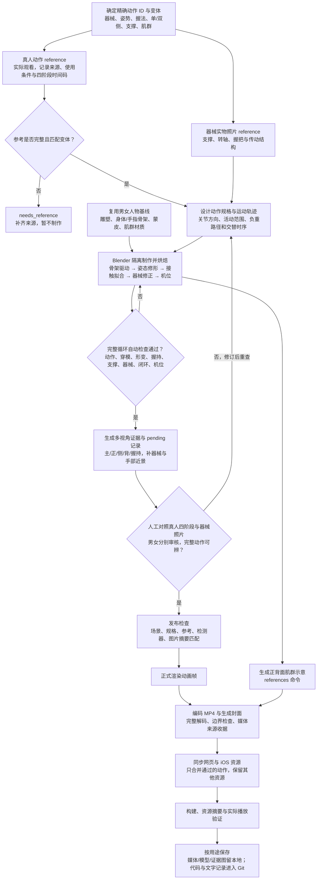

# 原创动作动画制作流水线

当前制作入口按范围选择：完整动作库的新批次使用 `Scripts/animation_samples/library_pipeline.py`；已有 19 个计划动作使用 `plan_pipeline.py`；`pipeline.py` 仅记录原深蹲、卧推、坐姿划船的历史流程。新增动作可以复用人物、骨架、肌群、渲染和交付步骤，但运动轨迹与接触约束仍需实现、校准和目视审核；当前不是输入动作名称就自动生成正确动画的系统。

## 当前制作流程框图

以下是新库动作及修订动作的主流程。框图中的来源观察和画面审核需要实际查看；自动程序负责验证记录完整性、数值约束和文件版本一致性。角色基线来自已完成的概念图 → Tripo 建模与初始绑定 → Blender 清理、身体/手指骨架、权重和肌群材质校准，每个动作复用男女角色。



正式渲染、打包和同步会再次调用发布检查，任何阶段失败都停止交付。修改参考、动作规格、场景或审核图片后，应从受影响的检查和审核步骤重新执行，不能只把旧报告中的哈希换成新值。修改共用人物基线前另跑代表动作回归，再重验受影响的已有动作；该专项回归仍需单独调度。

### 阶段与实际入口

| 阶段 | 入口与产物 | 执行方式 |
| --- | --- | --- |
| 真人参考与变体匹配 | `docs/motion-references/*.json`；`motion_reference_gate.load_reference()` | 人工观看与记录；烘焙前自动检查整批及单动作 |
| 器械参考 | `docs/equipment-references/`；独立机构模型与检查器 | 人工看实物照片；结构与运动另做数值和画面验证 |
| 动作制作 | `library_pipeline.py bake` → `build_sculpture_scene.py` | 脚本烘焙；人物、轨迹、接触、器械和机位需先实现校准 |
| 全帧检查 | `library_pipeline.py audit`；`library_audit_v*.py`、`motion_reference_gate.py`、单臂机位检查 | 自动；关键帧诊断不能替代全循环发布检查；独立器械验证按动作补跑 |
| 证据与审核 | `review` → `compose`；`*-review-pending.json` → 人工填写 `*-review.json` | 自动生成图片与模板；人工对照四阶段、五视角及完整动作后接受 |
| 渲染与打包 | `render`、`references`、`package`；MP4、封面、`*-media.json` | 自动检查通过后输出；`references` 是肌群正背面示意，不是搜集真人参考 |
| 合并交付 | `sync`、`page`；App `catalog.json` 与预览页 | 自动预检所选男女版本，再保留其他条目并合并资源 |
| 最终验证与保存 | 媒体解码、Xcode 构建、构建资源摘要、网页/真机播放；Git 私有资产检查 | 构建及真实播放需另行执行；媒体与模型不进入 Git |

### 当前覆盖与迁移边界

2026-10-31 本次核对时，App 有 **66 个动作、132 段男女视频**。新真人参考门禁完整通过的为 **4 个动作 / 8 个版本**：双臂直立划船、单臂直立划船、坐姿单臂锤式弯举、站姿交替哑铃臂屈伸。

- 其余 **42 个库动作 / 84 个版本**只保留完全相同场景和规格的历史兼容资格，状态是 `legacy_reference_review_pending`。修改或重新烘焙必须先补真人参考。
- 原 **19 个计划动作**仍走 `plan_pipeline.py`，尚未接入新的真人参考门禁；旧深蹲另保留待现行流程复核。图示不能作为这些历史动作已经完成 reference 审核的证明。
- `upright_row_shoulder_height_v1` 含直立划船专用数值检查；`visual_reference_v1` 负责参考记录与画面对照绑定，动作本身仍由对应 `library_audit_v*.py` 检查。两者都不能替代专业人员对人体运动合理性的判断。

本次流程核对：52 项流水线测试、14 项核心测试、6 项私有资产保护测试通过；92 个已交付库版本的发布检查通过，66 项 App 的视频及封面摘要一致。此次核对没有重渲染，也没有重新批准人工动作审核；提交只包含代码、文字报告和文档。

## 人体动作参考前置要求（2026-10-30）

**每个新动作及动作修订必须先找到对应的真人图片/视频，再制作和对照验收。** 具体执行 [动作参考规范](motion-references/README.md)，来源选择见 [来源调研](exercise-motion-source-research.md)。仅有器械照片、动作名称、文字指令或另一段合成动画不够；动作参考必须匹配器械、站/坐姿、单/双侧、握法及支撑方式。

先核实来源与使用条件，记录准备、发力、峰值、回程的图片位置或视频时间码；再确定关节运动与负重路径，输出对应视角的男女关键帧，逐项比较肩—肘—腕、髋—膝—踝及躯干。来源之间的幅度差异必须解释，不能从单张透视图片硬算三维角度，也不能照搬动捕数据中学员的错误动作。找不到足够参考的动作标记待补参考，不进入正式制作和验收。

**碰撞、骨长、形变与握持检查通过，不等于人体运动合理。** 0437 双臂哑铃直立划船出现用户指出的肩肘失真，原目视验收漏检；0363 单臂版本共享该运动分支，因此一并重新制作。两项原有自动报告保留为历史技术结果，不能据此宣称动作质量已通过。本次已补真人参考并修订轨迹，4 个男女候选完成新门禁与对照审核；重制及交付证据见 [直立划船修复记录](animation-library/upright-row-repair.json)。

完整动作库入口现已接入 `motion_reference_gate.py`：`library_pipeline.py bake` 在启动任何 Blender 任务前检查整批参考，底层 `build_sculpture_scene.py` 的库动作烘焙入口也检查；完整 `audit` 生成当前场景对应的 `*-reference-audit.json`。`compose` 只生成待填写的四阶段对照记录，正式 render、package、sync 和 App 素材校验通过 `library_gate.py` 要求已审核的真人来源与当前场景、规格、检查器摘要匹配。参考修改、阶段缺失、只审核一个性别、旧报告或旧对照图均不能发布。

直立划船使用专用 `upright_row_shoulder_height_v1` 检查：逐帧核对抬臂幅度、肘屈曲、腕线及前臂朝向，峰值检查腕位于肘内下方且负重位于身前；该动作不能降级成仅目视检查。其他新动作仍需根据自身参考补专用约束，`visual_reference_v1` 仅记录参考对照，不证明生物力学正确。

迁移范围：`legacy-scenes.json` 只保留其余 42 个已交付库动作的 84 份原场景及规格摘要，用于复用完全未改动的历史成品；不是通过新参考标准。任何重新烘焙仍必须先补参考，修改后的场景不匹配旧摘要即失去兼容资格。`inventory.json` 的 `motionReferenceStatus` 区分新参考通过与历史待补参考。原 19 个计划动作的 `plan_pipeline.py` 不在这次库入口迁移范围。

**后续批次的共用人物基线包含小腿/膝部轮廓、自然站姿及按动作选择的肩带修形。** 开始制作前按本文末尾“肢体轮廓与肩带修形”中的执行顺序和验收清单操作。修正已接入共用生成代码；新动作继承代码不等于自动通过审核，已有视频也不会随代码更新自动重制。

## 单臂动作的主镜头与演示侧

单臂动作必须让**负重手处于主镜头近侧、身体外侧**，使肩—肘—腕、握柄和负重路径在准备、发力、峰值与回程都可辨。不能用空闲手占据前景、让负重臂藏在躯干后方；补拍手部近景不能代替正式视频的可见性。男女分别查看主画面，不因同一镜头参数而合并验收。

当前左手负重的动作将主镜头放到人物左侧，不对视频、文字或人体做水平镜像。`build_sculpture_scene.py` 在最终接触拟合后调用 `active_side_camera.aim()`，再按完整运动范围拟合画幅。动作与器械几何不变；如果将来选择右手负重，按实际骨骼与观察方向判断近侧，不能照抄固定镜头符号。

`library_pipeline.py audit` 对单臂动作追加 `active_side_camera.py audit`，读取保存后的真实场景，检查输出帧及闭环帧中负重肩沿镜头方向的深度比空闲肩更近，并以反向机位作真实场景反例。发布门禁要求当前场景和检查器摘要匹配的 `*-camera.json`，以及实际查看主画面后填写的 `activeSideViews`、`activeSideFrames`、`activeSideEvidence`。深度检查只保证机位在负重侧，不能证明肘腕、握柄或器械无遮挡，仍需目视检查完整动作路径。

已有动画的机位修正先在候选目录运行 `active_side_camera.py reframe`，保存完整循环网格不变证明；再重新执行全帧碰撞/形变/动作检查、多视角画面审核、正式渲染、媒体打包与 App 校验。旧审核和旧视频不会因移动镜头而自动有效。 对属于 `equipment_refit_catalog.MOTIONS` 的动作（如 `single_incline_press`），还须在候选目录补跑 `verify_equipment_refit.py --before <原目录>` 并重建器械主/侧视图审核；新场景摘要也会使原独立器械记录失效。发布时只合并相应动作的器械记录，保留其他记录。

现有 **11 个单臂动作 / 22 个男女版本**已按此规则完成机位修正、全帧重新检查、实际画面审核和媒体交付；动作与器械网格逐帧不变。其他 53 个动作保持原样，App 构建和 22 段 HTTP 媒体校验通过。见 [单臂演示侧交付记录](animation-library/active-side-camera.json)。

## 原三动作入口（历史）

生产环境为 macOS、Blender 5.2.1 LTS、Python 3 + Pillow、ffmpeg/ffprobe。Blender 自带 Python 负责 `bpy` 与 NumPy；外部 Python 负责批处理和 Pillow 排版。三个命令行程序必须在 PATH 中。中文卡片当前依赖系统的 Hiragino Sans GB 与 Arial 字体。

在项目根目录运行（`python3` 应选用安装了 Pillow 的解释器）：

```sh
# 查看阶段和命令，不修改文件
python3 Scripts/animation_samples/pipeline.py --dry-run

# 完整重建当前全部三个动作、男女版本、模型与验证结果
python3 Scripts/animation_samples/pipeline.py --mode full

# 验证已有结果，不重新渲染或打包
python3 Scripts/animation_samples/pipeline.py --mode verify
```

该入口记录原三动作制作方式。当前卧推/划船已纳入 19 动作形变门禁，应使用本文后面的 `plan_pipeline.py --prepare-review` / `--from-scenes` 流程；旧 `full` 不能跳过新审核要求。`full` 会更新现有 v2 成品目录。`verify` 需要本地渲染中间帧；这些位于忽略的 `build/`，新 checkout 应先运行 `full`。执行前会检查工具、输入文件和字体，阶段失败即停止。每次运行的阶段状态、命令与日志位于 `build/animation-pipeline/<UTC 时间>/`。运行成功只代表自动检查通过，不代表专业动作审核通过。

单个动作的快速迭代继续使用底层入口：

```sh
# 烘焙动作并输出关键姿势（会更新对应 Blender 场景）
python3 Scripts/animation_samples/render_sculpture_samples.py \
  --exercise squat --sex male --previews-only

# 只重渲染这个动作的男女版本
python3 Scripts/animation_samples/render_sculpture_samples.py --exercise squat
```

预览模式不是隔离沙盒，可能使对应 `.blend` 比旧视频更新。确认预览后应跑完整流水线，使场景、视频和报告对应同一版本。

## 原三动作阶段与代码（历史）

| 阶段 | 输入与工作 | 实现 / 输出 |
|---|---|---|
| 人物准备 | 读取选定雕塑；校准手脚、五指权重、肩颈形体；保留源档 | `character_assets/hand_rig.py`、`shoulder_rig.py` |
| 动作与器械 | 求解髋、四肢、手腕、接触目标；建模器械；烘焙 121 帧 | `animation_samples/build_sculpture_scene.py` |
| 渲染 | 两个有限并发 worker；动作与正背面肌群参考 | `render_sculpture_samples.py` |
| 接触近景 | 检查实际握持、肩颈与落杠；正/背/侧视角 | `render_hand_closeups.py`、`render_squat_review.py` |
| 独立人物导出 | 53 骨骼、五指张合、可编辑肌群开关 | `character_assets/export_hand_rig.py` → Blender / GLB |
| 打包 | 中文卡片、海报、MP4、GIF、预览页和文件校验和 | `package_sculpture_samples.py` |
| 验证 | 真实网格接触、循环、脚底稳定、媒体、GLB 重导入 | 五个 `verify_*` 阶段 |
| 目视审核 | 正背侧轮廓、关节、运动方向、器械支撑和肌群展示 | 预览页与源场景；确认后才可进入 App 资源制作 |

相对于 `Scripts/` 的路径如表所示。动作标题、数据集 ID、阶段文案和主要肌群集中在 `animation_samples/exercise_catalog.py`。几何轨迹仍在现有场景生成器中，尚未抽成通用动作插件。

## 输入与交付约定

- 固定输入：`docs/character-assets/muscle-overlay-v1/{male,female}/greek-*-muscles.blend`；原始人物、UV、肌群材质和身体骨架作为来源，制作副本中应用已验证的修正。
- 新人物的上游流程仍是：概念图 → Tripo 网格 → 人体绑骨 → 局部几何与蒙皮校正。它是角色制作阶段，不需要为每个新动作重复调用 Tripo。
- 当前归一化人物约 0.98 模型单位高，X 向前、Y 向左、Z 向上。动画中转换到约真人尺度，世界 Y 向前、Z 向上。
- 每段 5 秒、24 fps。1–120 帧播放；121 帧只用于验证闭环。1 帧为准备姿势，61 帧为最低点或收缩位置。
- `docs/animation-samples-v2/` 保存 MP4、GIF、Blender 场景、近景、报告和预览页面；`docs/character-assets/hand-rig-v1/` 保存可复用骨架副本。
- `build/` 保存原始帧、排版中间帧和日志，不提交。最终资产与验证报告提交到 Git。历史截图和肩部修正前图是审查记录，不会自动重建。
- 当前媒体已通过 `Scripts/prepare_animations.py` 接入 iOS 离线资源；原深蹲保留旧版本，19 个计划动作走下述形变门禁。

## 扩展一个新动作

1. **写清动作规格。** 确认名称与数据集 ID、器械、动作阶段、活动范围、主要显示肌群和正背侧参考。使用有许可的参考或原创动作，不复制来源不明的 GIF。
2. **选择现有运动模式。** 深蹲可提供固定足底与髋膝链参考；卧推可提供仰卧支撑与推举轨迹参考；划船可提供坐姿支撑、握把与绳索参考。相似动作也需重新检查角度、接触和肌群，不应仅改标题或器械外观。
3. **实现动作与器械。** 在场景生成器中新增明确分支，定义身体轨迹、手腕方向、接触点、器械跟随、相机及活动范围，然后注册元数据。沿用共用人物准备入口，明确自然站姿是否适用、肩部采用哪种修形；不能把已知动作的例外按名称相似性直接套给新动作。只添加 catalog 项目不会自动获得正确运动求解。
4. **先出关键姿势。** 检查准备、中间、终点和回程；同时看正面、背面、侧面。除错误扭转、浮空、身体/器械穿模和脚滑，还要查看小腿—跟腱—膝部过渡、静止屈膝量、肩腋鼓包或塌陷。先修正这些问题，再渲染全片。
5. **增加该动作的接触验证。** 实际蒙皮应参与检查。根据动作检查手/握把、肩/杠铃、背/靠垫、脚/地面或踏板等；不要只比较骨骼目标位置。
6. **接入批处理与验证列表。** 在对应 catalog 和动作适配器中注册规格，选择或扩展专用动作检查器，补充完整循环采样、器械坐标系和约束，再纳入当前流水线。新身体、不同杆径或新握法也要重新校准。
7. **完整制作、审核、交付。** 保留原场景、参数、验证结果、版本和校验和；确认男女版本都合理，再作为独立资产导入 App。

当前复用共用人物与检测引擎，运动语义仍由各动作适配器和专用检查器负责。新增配置必须有真实场景与验收证据，不能把尚未验证的动作假设藏进通用配置。

## 本轮经验与自动检查的边界

| 已发生的问题 | 为什么旧检查漏掉 | 已补充的检查 |
|---|---|---|
| 手没有握杆 | 手掌参考点正确，但没有逐指骨骼 | 30 根指骨实际带动蒙皮；杆周围包覆、各指接近杆面、相对器械滑移 |
| 杠铃穿肩 | 固定偏移和握点无法证明躯干接触正确 | 变形网格的杠轴表面/轴心检测、三向射线体内判断、双侧上背间隙 |
| 颈后隆起、肩部扭曲 | 原始形体、错误权重和不稳定上臂旋转叠加 | 颈后网格相对躯干的偏移；正/背/侧面轮廓对照 |
| 脚底随腿形变漂移 | 固定踝骨不等于固定脚底网格 | 实际足底顶点的世界坐标漂移 |
| 媒体截边或模型导出失效 | 渲染成功不代表交付可用 | 720 帧透明边界、完整媒体解码、GLB 重导入及指骨形变 |

现有报告覆盖本轮设置的采样和约束，不是全身通用碰撞或生物力学正确性的证明。五指目前是 FK；肌群为体表近似区域，衣物折痕也会保留。专业动作审核和目视检查仍是必要的质量步骤。

## 穿模检测与 19 动作生产流程

新增 `Scripts/animation_samples/plan_pipeline.py`，将检测作为渲染、打包和 App 资源同步的前置条件。使用带 Pillow 的 Python：

```sh
python Scripts/animation_samples/plan_pipeline.py --prepare-review
# 查看生成的三视角证据，记录审核决定后（不得自动批准）：
# 已在 Blender 中调整过场景，保留编辑结果：
python Scripts/animation_samples/plan_pipeline.py --from-scenes
```

顺序：烘焙 19 动作的男女场景 → 检测器回归测试 → 全帧穿模检测 → 全帧形变检查 → 三视角审核 → 渲染 → 握持/循环/支撑检查 → 视频打包 → App 同步 → 资源完整性检查。`--dry-run` 仅打印步骤。原有深蹲不属于本次计划的 19 个动作，仍保留原资源。

### 检测覆盖

- 在最终变形后的网格上检查，包含骨骼、握持形态修正、关节修正和垫面接触修正；不能用骨骼距离代替皮肤表面。
- 双向检查人物进入器械、器械进入人物。器械长边按 12 mm 间隔细分采样，避免细杠杆两端都在体外时漏检。
- 对非局部身体表面进行三角形相交检查，包括双侧肢体、手/前臂与躯干、头部等。共用顶点、同一解剖表面，以及原始模型中相距不足 14 cm 的相邻关节连接区域不作为独立碰撞体。指间和局部皮肤褶皱仍需近景目视审核。
- 穿透容差固定为 2 mm，不允许为某个失败器械整体放行。自碰撞的深度是相交面片的平面侵入量，用于定位和阻断，不是物理软组织压力。
- 正式检测覆盖每个输出帧和额外的循环闭合帧；死虫式完整覆盖两侧。离散帧检查不代表连续物理仿真。

```sh
# 快速诊断，不能用来授权导出
python Scripts/animation_samples/validate_collisions.py --frames key
# 指定动作重新检查；默认就是全部帧
python Scripts/animation_samples/validate_collisions.py --exercise leg_press
# 全部 38 个场景
python Scripts/animation_samples/validate_collisions.py
```

失败报告记录性别、动作、帧、器械、身体区域、位置、侵入量和交叠面片。诊断文件在 `build/collision-audit/`；正式证据在 `docs/animation-plan-v3/collision-validation.json`。修改场景或检测器后，旧报告自动失效。未完成全部帧、存在失败项、哈希不符或缺少报告时，渲染和打包必须停止。

### 几何修复原则

`fit_contacts.py` 用整个循环的实际皮肤表面设置静态坐垫/靠垫，避免垫子跟随皮肤抖动；踏板和滚垫按实际运动接触面设置轨迹。握把连接杆从握持区以外的端部接出。旧 `joint_correctives.py` 的强普通 Smooth 已删除。现在使用共享绑定校准、父级坐标系下的旋转、前臂扭转辅助骨骼和原生 Preserve Volume；接触形态修正仍接受同样的检测。不能隐藏器械、删除身体面片、扩大检测豁免范围或更改训练计划来消除报错。

检查通过后还需查看主镜头及侧面关键姿势：手是否包住握把、器械是否有支撑、轨迹是否符合动作、皮肤修正是否造成塌陷或鼓包。`*-media.json` 将视频/封面哈希与已通过检测的场景绑定；`prepare_animations.py` 会拒绝来自旧场景的视频。


## 人物形变流程 v2（2026-10-29）

`character_assets/prepare_athlete.py` 是当前 19 动作与独立关节测试的同一入口。原人物、UV 与肌群来源保留；制作副本增加 4 根前臂扭转辅助骨，共 57 根骨骼。独立中性资产和测试片位于 `docs/character-assets/deformation-rig-v2/`。旧 `hand-rig-v1` 导出是历史 53 骨版本，不能当作新绑定。

1. 校准脚踝/脚趾旋转中心及局部权重，限制足骨对小腿的拖拽；肘膝按关节中心分配相邻骨骼影响。
2. 肩、上臂、前臂使用父级传递的旋转参考；握持方向产生的轴向转动分布到前臂辅助骨。自由手不使用虚构器械握点。
3. Blender Armature 开启 Preserve Volume（双四元数蒙皮）。接触修正的逆映射与其一致，并用实际求值网格验证误差；不使用普通强平滑掩盖折叠。
4. `joint_stress.py` 生成肘、前臂、肩、髋、膝、踝、趾的独立活动测试。极端测试角度是查错输入，不是训练动作范围建议。
5. `validate_deformations.py` 检查完整循环的权重归一化、异常骨缩放、相邻帧旋转跳变、肘部额外轴转、脚骨影响范围和强平滑回归。网格边长变化仅标记可疑帧，不据此证明解剖正确。
6. `render_deformation_review.py` 输出正/侧/背关键帧与可疑帧；`compose_deformation_review.py` 只生成 pending 记录。实际查看后才可在 `deformation-visual-review.json` 写入 accepted、审核说明与对应图片哈希。器械在该人体形变视图中暂时隐藏；完整场景碰撞审查独立保留。
7. `deformation_gate.py` 要求自动检查与目视证据同时对应当前场景哈希。缺少、过期或失败时，正式渲染、打包、App 同步停止。

隔离制作可给 `render_plan.py` 传 `--output-root build/候选目录`，给两个 validator 和形变 review 脚本传 `--root build/候选目录`。输入角色仍来自仓库，输出不会覆盖已交付文件。只有检查/审核通过的候选场景、报告和证据才可推广；场景重新烘焙后必须重新检查。

本轮接受的是当前 19 动作范围内的示意画面。原雕塑的衣褶、腋下折痕与极端膝踝姿态的局部形状仍存在；这不是肌肉/软组织物理模拟，也不是专业动作审核。新动作超出现有范围时需重新做关节与多视角检查，必要时重拓扑或制作姿态修正形态。

独立关节基线可以单独生成，不改动作成品：

```sh
blender -b --python-exit-code 1 --python Scripts/character_assets/joint_stress.py -- --sex male --output-root build/rig-review --render
blender -b --python-exit-code 1 --python Scripts/character_assets/joint_stress.py -- --sex female --output-root build/rig-review --render
```

接触逆映射的保留厚度模式还检查左右 Shape Key 独立性；旧硬投影配方只为已验收动作兼容保留。新增握持动作优先试用保留厚度模式，但仍须检查每指接近杆面，不能通过扩大间隙换取碰撞通过。

### 握持方向与手腕约束

表面包覆检查回答“握住了吗”，不能回答“握反了吗”。卷腹增加 `verify_grip_orientation.py` 全 121 帧动作专用检查：两掌向内、拳头食指端朝上、轴转和折腕角度。此步骤放在形变检查之后、视觉审核之前；`deformation_gate.py` 在正式渲染、打包和 App 同步时强制检查报告、全帧覆盖、场景/检测器哈希及指标。

```sh
blender -b --python-exit-code 1 --python Scripts/animation_samples/verify_grip_orientation.py
# 隔离输出可用 -- --root build/候选目录；--frames 61 仅诊断，不写生产报告。
```

`render_deformation_review.py` 为卷腹额外输出器械可见的四阶段手部近景；`compose_deformation_review.py` 将其纳入审核证据。两者支持 `--exercise cable_crunch`，但不会自动批准。`verify_plan_grips.py` / `verify_plan_scenes.py` 的同名选项生成带动作名的独立报告，避免部分审查覆盖全部结果。其他动作后续应按正握、反握、中立握等明确各自语义，不能套用卷腹阈值。


### 死虫式肩腋姿态修正

`bake_shoulder_correctives.py` 在原 Armature / Preserve Volume 后增加局部姿态修正 Shape Keys。原网格、UV、骨架和手脚轨迹保留；不是替换蒙皮算法，也不宣称已经修好角色在所有动作下的肩部绑定。

- `shoulder_volume.py` 对肩腋局部执行保形表面求解，并用躯干、上臂体积引导避免单纯平滑导致上臂塌陷。男女分别校准；女性前肩衣褶另有随抬臂相位渐变的保护区域。
- 每 8 帧求解一个姿态，周期插值后将 Shape Key 权重逐帧烘焙。通过与 DQ 蒙皮一致的逆映射写回形态；不改变原骨长或动画。缓存绑定未修正场景、求解器、逆映射代码及 Blender 版本。
- 对插值后的每帧实际皮肤再做局部肩腋接触修正。修正位移过大或不收敛则失败。独立穿模检测仍使用原来的 2 mm 容差；没有扩大检测豁免范围。
- `diagnose_torso_strain.py --all-frames` 检查全部 193 帧（含闭环帧），肩腋区域边长拉伸 p95 必须 ≤1.8。这是针对已知缺陷的回归阈值，不是人体生理标准。`deformation_gate.py` 同时核对完整帧覆盖、场景及检测器哈希。
- 仍需全循环形变/穿模检查、网格闭环检查、正侧背视图与 `dead_bug-shoulders.jpg` 近景的实际审核。单靠边长变小不能验收：塌陷也会让指标变小。局部雕塑折痕及衣褶仍会存在。

该配方只支持当前两个人物和 192 帧死虫式循环。新人物、拓扑或抬臂轨迹必须重新校准；不能直接用于其余动作。

Blender 5.2 / Python 3.13 的求解阶段需要 SciPy。Apple Silicon 开发环境可安装到被忽略的项目目录，不修改 Blender 应用：

```sh
python3 -m pip install --target build/deformation-python --no-deps --only-binary=:all: \
  --platform macosx_14_0_arm64 --implementation cp --python-version 3.13 --abi cp313 scipy==1.18.1
# 其他平台应匹配 Blender 自带 Python 的 ABI/架构；可用 REPCENDO_DEFORMATION_MODULES 指定安装目录。
python3 Scripts/animation_samples/render_plan.py --bake-only --exercise dead_bug --output-root build/dead-bug-candidate
# render_plan 的新烘焙会自动执行姿态修正及逐帧拉伸检查。
# 手工修改已有场景后，先重新运行逐帧拉伸检查，再进入原有 audit / review / render 流程：
blender -b --python-exit-code 1 --python Scripts/animation_samples/diagnose_torso_strain.py -- \
  --scene build/dead-bug-candidate/docs/animation-plan-v3/male/dead_bug.blend \
  --all-frames --output build/dead-bug-candidate/docs/animation-plan-v3/male/dead_bug-strain.json
```

直接调用修正脚本时必须输入未修正的场景；存在 Shape Keys 时会拒绝重复烘焙。`*-shoulder-corrective.json` 记录制作来源；发布仍由独立检查和视觉审核决定。

## 完整动作库分批制作（2026-10-29 起）

目标为 App 文本库的 1,324 个精确动作 ID、男女各一版。`docs/animation-library/inventory.json` / `inventory.csv` 是可重新生成的制作清单，不是成品覆盖声明。`library_exercises.py` 只注册已编写独立规格和适配器的动作；未实现项目不能按相似名称套用现有视频。

新批次放在 `docs/animation-library/`，不会覆盖原三动作和计划动作目录。共用人物准备、骨长约束、前臂扭转及原来的实际网格碰撞/形变检测引擎。每个新动作还需完整循环的握持语义、逐指接触、足底稳定和网格闭环检查。第 001 批实现中立握的站姿/坐姿锤式弯举、旋后握的左右交替弯举、正握前平举；交替动作包含左右完整循环。

```sh
# python 选用带 Pillow 的解释器；Blender / ffmpeg / ffprobe 仍需在 PATH。
python Scripts/animation_samples/library_pipeline.py bake --batch 001
python Scripts/animation_samples/library_pipeline.py audit --batch 001
python Scripts/animation_samples/library_pipeline.py review --batch 001
python Scripts/animation_samples/library_pipeline.py compose --batch 001
# 实际查看每个 *-review.jpg，记录到同名 *-review.json。
# 自动生成器只写 *-review-pending.json，不会自动批准。
python Scripts/animation_samples/library_pipeline.py render --batch 001
python Scripts/animation_samples/library_pipeline.py references --batch 001
python Scripts/animation_samples/library_pipeline.py package --batch 001
python Scripts/prepare_resources.py
python Scripts/prepare_animations.py --library-batch 001
python Scripts/animation_samples/library_pipeline.py page --batch 001
python Scripts/animation_samples/library_inventory.py
```

每阶段支持 `--exercises` 指定动作，制作/检查阶段还支持 `--sex`；每次最多两个 worker；跨进程文件锁保证同一工作目录最多两个 Blender 子进程，同一动作/性别的制作阶段串行。`--root` 用于隔离候选。视频断点续作绑定场景 SHA-256，场景变化时只清除该动作的旧渲染帧。正式打包前检查全部 alpha 边界，编码后完整解码并核对尺寸、帧数及媒体来源。每项报告独立保存，缺少、过期、失败或被撤回的视觉证据均拒绝输出。

`prepare_animations.py --library-batch` 先检查选中批次男女两版的全部证据，再加入该批次媒体；其他现有文件与目录项保留。该命令不会自动重审或放行其他动作；旧版深蹲仍单独标记，死虫式现已通过肩腋专项修复和重新验收。原默认 `prepare_animations.py` 保留旧流程的整体门禁。

原始帧、诊断和日志在忽略的 `build/animation-library/`；已验收源场景、视频、封面和报告在 `docs/animation-library/`。制作全库应逐批完成，避免将数十万原始帧同时留在磁盘；未经复验不得清理正在制作批次的帧。

第 002 批新增 1648、1677、0392、0387、0396、0429、0311、0335；使用同一命令将 `--batch` 改为 `002`。全帧检查增加闲置侧手臂稳定、峰值动作幅度、full-can 拇指方向与肩胛平面，以及侧举/前举阶段的实际方向。`audit --frames 1,31,61,91,121` 可生成关键帧诊断，但不能用于正式发布。检查器更新后必须重跑此前批次的实际场景和媒体校验。预览按批次筛选，男女视频均使用内容哈希刷新缓存。


第 003 批使用 `--batch 003`，新增 0289、0352、0321、3545、0388、0404、0426、0427。平凳、45° 上斜、坐姿和站姿分别建模；中立握保持掌心相对，交替推举包含左右完整循环。0404 上游文字的掌向错误由 `prepare_resources.py` 中的显式覆盖修正，不改上游子模块。

推举的独立检查入口为 `library_scene_v3.py` / `library_audit_v3.py`，通过规格的 `audit_version=3` 选择，并将动作规格摘要绑定到检查报告与媒体收据。原批次仍使用原检查器；共享碰撞/形变引擎变化时，所有受影响的报告仍必须真实重查。v3 检查实际腕肘对齐、推举顶部范围、闲置侧稳定、每指握杆表面、靠垫的实际承重蒙皮间距、脚部稳定和闭环。平卧额外分别检查上背与后脑支撑，避免仅用臀部最低点通过。`audit --frames key` 检查九个关键帧，仅输出 build 中的诊断报告，不能替代全帧检查或视觉验收。

第 004 批使用 `--batch 004`，对应 0315、0320、0298、0439、0414、0415、0406、0293，采用独立 `library_scene_v4.py` / `library_audit_v4.py`，保留旧版检查器。上斜弯举检查靠背/坐垫承重间距和上臂垂直悬垂；跨体锤式检查交替、跨中线趋势和拇指端方向；佐特曼检查旋后举起、顶部旋前、旋前下放及底部复位，连续帧仍执行旋转跳变检查；耸肩检查直臂、肩部位移和躯干稳定；俯身划船检查固定髋铰链与肘部后拉。所有项目继续使用实际蒙皮、双向器械穿入和非邻接自交检查，容差保持 2 mm。

佐特曼的四阶段不是等时长，`phase_ends=(0.375, 0.5, 0.875, 1.0)` 将视频阶段文字与 8 秒动作对齐；顶部/底部转腕额外加入多视角审核帧。不能只以顶部与底部姿势正确证明翻腕连续。旧失败样本保留在 `build/animation-library/batch-004-diagnostics/`。

## 器械照片参考与机构验收（2026-10-30）

新增或修订器械先执行 [照片参考流程](equipment-references/README.md)，把实际查看的产品照片和结构观察记入 `docs/equipment-references/`。照片结构审核独立于人体形变和穿模检查。

蝴蝶机夹胸/反向飞鸟共用 `pec_deck.py`：参照 SS-FLY 的顶部双竖直转轴、横向摆臂、下垂握臂、胸背垫、座椅和配重塔。拳心沿固定半径圆弧，手臂 IK 匹配握把；杆件保持定长。男女分别适配静态握把高度与臂长，行程中不伸缩。女性使用保留指厚的握持修形，男性保留经全循环验证的既有接触配方。

`verify_pec_deck.py` 检查每版全 121 帧的固定转轴、杆长、连接点和竖直握把，并绑定参考记录/检测器/场景哈希。`render_pec_deck_review.py` / `compose_pec_deck_review.py` 生成器械可见的主镜头、侧面三阶段证据；与人体正侧背图一起实际查看后，将设备图片哈希加入视觉审核记录。形变门禁同时要求该机构检查和设备图片；旧的伸缩斜杆场景会被拒绝。上述命令均支持隔离 `--root`，并已接入 `plan_pipeline.py --prepare-review`。

此器械是保留结构和运动原理的简化示意模型，未复刻厂家全部传动零件或尺寸。其他旧器械仍需逐项补做照片审核，不能因本次四个场景验收而认为它们已通过。

### 全器械照片复核与更新

现有资产的照片索引见 `docs/equipment-references/README.md` 和 `equipment-audit.json`。`equipment_refit.py` 在接触拟合后补齐承力架及传动，不修改人物。覆盖高低位绳索、腿机、提踵机、腿举和 8 种带靠背的训练凳动作。

`verify_equipment_refit.py -- --root <候选目录> --before <原场景目录>` 检查每一帧固定架、连杆长度、导轨方向、配重与绳长关系，并比较前后人物网格。`render_equipment_review.py` / `compose_equipment_review.py` 输出主、侧镜头三姿势图片；必须实际查看再写 `equipment-visual-review.json`。`equipment_gate.py` 同时用于计划和新增动作库的发布检查。

人体每帧网格完全一致时，可以保留旧人体多视角证据，但必须记录原场景摘要、完整循环人体摘要和比较证明，并附上新的器械图；不能把旧图当作新器械验收。任何人体改变仍需重新制作人体证据。新器械仍必须跑原有碰撞/形变/动作检查，未经完整验收不替换成品。


### 第 005 批：单臂动作与新握持配方

第 005 批对应 1670、1671、0425、0355、0361、0424、0343、1281，使用 v5 独立动作检查。每段演示左臂一个循环，空闲手张开放松且没有哑铃，文案提示完成一侧后换侧；它不是左右交替动作。三种弯举分别验证旋后、中立、旋前握法；侧平举及三种方向的推举按实际骨骼与蒙皮核验活动范围。

新场景优先采用 `contact_recipe="preserve_thickness"` 的双四元数逆映射握持修形，空闲手的器械接触 Shape Key 设为零。对全部输出帧重新检查每指接近杆面、手腕方向和相对滑移，再查看手部近景，不因采用新配方自动通过。当前照片记录为 `equipment-references/batch-005.json`，其摘要也进入 v5 检查与媒体收据。

平凳纵梁在坐垫接触拟合之后连接垫底，不能使用原始固定高度穿入人物。上斜凳继续通过 `equipment_refit.py` 补齐背撑，并由 `verify_equipment_refit.py -- --exercise single_incline_press` 检查完整循环。主、侧准备/中间/最大行程图均包含在本批五视角证据中，实际比较照片后才记录器械通过。每版重新制作人体证据，不复用旧人体截图。

验证命令仍使用 `library_pipeline.py ... --batch 005`。`test_unilateral_scenes.py` 在内存中制造握反、双侧负重、空闲臂随动、哑铃伸缩、凳面漂移和错误支撑的真实场景反例；不修改交付场景。保留原碰撞与形变检测器，穿透容差仍为 2 mm。

本批卧推另执行 `render_equipment_review.py -- --exercise single_bench_press single_incline_press` 和 `compose_equipment_review.py --exercise single_bench_press single_incline_press`，按完整器械边界取景，保留主/侧三姿势证据；v5 门禁要求这部分图片也进入同一场景的视觉审核记录。

从 v5 起新增动作的默认握持配方为保留指厚。`grip_surface.py` 在修形前对握柄附近跨弧较大的手部边做局部细分，保留原面片、UV 和插值权重，避免粗三角面的弦切过圆握柄；修形半径和 2 mm 穿模容差不随之扩大。仍以实际网格的完整检测和手部近景决定是否接受。

## 肢体轮廓与肩带修形（2026-10-30）

### 已接入的共用修正

`prepare_athlete.py` 现在调用 `limb_shape.py`，在制作副本上收敛过圆的小腿肌腹并缓和膝盖前侧突起。男女采用不同强度，沿踝—膝轴平滑衰减；不改变腿长、足底、拓扑、UV 或骨骼权重。原始雕塑保留，带版本标记的修形拒绝重复应用。`test_limb_shape.py` 检查这些边界与不变量。

默认站姿改为按两侧实际骨长求髋高，膝屈目标为 6°，替代固定降低髋部 32 mm 的旧做法。原模型两腿存在差异，因此实际两侧角度不完全相同；`test_relaxed_stance.py` 将安静站姿的 3–15° 作为本人物的外观回归范围。它不是训练动作的关节活动范围建议，深蹲仍使用自己的轨迹，罗马尼亚硬拉保留髋铰链所需的独立屈膝余量。

`shoulder_blend.py` 只在躯干、肩带与上臂混合权重区域烘焙 DQ 到线性蒙皮目标的局部修形，缓解抬臂时侧胸向外鼓起。Armature 继续使用 Preserve Volume，纯上臂、肘、腕、手指不进入该混合区；骨骼轨迹不变，也不增加普通 Smooth。男性坐姿交替、坐姿中立握、站姿中立握及单臂中立握推举采用 0.5 混合强度，避免前伸上臂压入腋下；其他采用该配方的动作默认强度为 1。每 4 帧采样 Shape Key 并周期线性插值，记录配方版本、强度和摘要；必须对插值后的完整循环重新检查，不能用采样帧代替全帧验收。

深蹲及平卧的杠铃/哑铃/中立握/单臂卧推不套用此肩带配方，保留各自已有的肩部蒙皮；平卧伸臂与站姿抬臂的腋下接触不同。死虫式保留其独立体积修正流程，不叠加两种肩部配方。旧媒体不会因共用代码更新而自动变成新版：每个候选均需新的场景摘要、人体多视角证据、器械接触检查和正式媒体收据，再替换 App 资源。`test_shoulder_bulge.py` 对保存的真实前后推举场景作回归比较；局部膨胀指标只证明已知缺陷减轻，不能代替目视审核或证明全身解剖正确。

### 后续动作的制作顺序

1. **准备候选与来源。** 使用隔离输出目录，保存修改前的场景和摘要。通过 `prepare_character()` 从源雕塑生成制作副本，默认开启 `limb_refinement`；关闭该选项只用于前后诊断，不作为新成品的常规入口。不得对已经修形的网格再次应用相同配方。
2. **确定动作轨迹。** 安静站立使用按实际骨长求解的自然站姿；髋铰链、深蹲、坐姿、卧姿按各自动作约束处理。6° 目标和 3–15° 回归范围只用于本人物的安静站姿，不是所有动作的膝角限制。
3. **完成姿态修形，再拟合接触。** 当前 `build_sculpture_scene.py` 的顺序为动作/握持修形与适配器完成 → 适用的肩带修形 → `fit_contacts()` → `equipment_refit.refit()` → 保存最终场景。靠垫、座垫和器械支撑必须匹配修形后的实际皮肤，不能沿用旧人体的接触证明。死虫式继续走其独立肩部流程。
4. **检查完整循环并制作新证据。** 男女分别运行对应入口的全帧碰撞、形变、动作与接触检查，覆盖输出帧及闭环帧；肩部 Shape Key 插值后的帧也必须检查。保留 2 mm 穿透容差。人体变化后重新渲染多视角、手部近景和适用的器械接触图，不能直接沿用旧审核。
5. **实际查看后才发布。** 按下表逐项检查，再填写带当前场景与图片摘要的审核记录。通过后才渲染、打包、同步 App；核对媒体解码、封面、资源摘要和构建结果。更改共用人物配方时先做代表动作回归，再重制和复验所有受影响的现有动作。

### 配方选择与视觉验收

| 部位 / 场景 | 制作规则 | 必看证据与拒绝条件 |
|---|---|---|
| 小腿、膝部 | 男女独立强度；保留足底、腿长、拓扑、UV、权重 | 正侧背视图检查肌腹、胫骨、跟腱与膝部连续过渡；拒绝球状鼓包、局部凹陷、左右异常和足底变化 |
| 安静站立 | 使用实际骨长求髋高；RDL 保留自己的屈膝余量 | 准备与峰值姿势均检查膝角、足底和腿部轮廓；拒绝恢复成半蹲或锁死反弓 |
| 常规肩带修形 | 适用动作默认强度 1；保留 DQ 主蒙皮 | 正侧背与抬臂峰值近景；同时检查鼓包、塌陷、自穿插、衣褶和动作连续性 |
| 男性四项推举 | `seated_alternate_press`、`seated_neutral_press`、`standing_neutral_press`、`single_neutral_press` 使用 0.5 | 检查前伸上臂与腋下间隙；已有全强度失败案例，不得直接恢复为 1 |
| 平卧推举 / 深蹲 | `bench`、`db_bench_press`、`neutral_bench_press`、`single_bench_press`、`squat` 不套用肩带混合 | 按各自肩部和支撑约束重新验收；排除配方不代表豁免检查 |
| 死虫式 | 使用独立肩腋体积修正，不叠加肩带混合 | 完整双侧循环、肩腋近景与专项拉伸检查；指标降低不能替代对塌陷的目视判断 |

上述例外是已验证的具体动作，不是所有未来同类动作的自动放行规则。遇到新姿势或新人物，先比较未修正、默认修正及必要的局部配方，再通过完整验收确定参数；不得用强平滑、扩大容差或隐藏器械来换取通过。

### 专项回归与交付记录

以下为修改共用配方时的独立回归，**尚未由 `library_pipeline.py` / `plan_pipeline.py` 自动调度**，应在批量制作前单独执行。它们不能替代每个动作现有的全帧发布门禁。命令在项目根目录运行，Blender 作业与其他制作任务合计最多两个并发。

```sh
# 男女局部轮廓边界、拓扑/UV/权重、足底/腿长及重复应用保护
blender -b --python-exit-code 1 --python Scripts/character_assets/test_limb_shape.py

# 安静站立代表动作；此处检查已交付男性单臂弯举，女性版本也须检查。
# 验证候选时将 --scene 替换为候选目录下对应场景。
blender -b --python-exit-code 1 --python Scripts/animation_samples/test_relaxed_stance.py -- \
  --scene docs/animation-library/male/single_curl.blend

# 本次肩部缺陷的真实前后场景比较（需要本地基线与候选）
blender -b --python-exit-code 1 --python Scripts/animation_samples/test_shoulder_bulge.py
```

站姿回归至少覆盖男女单臂弯举和单臂过顶推举；肩部配方变更还要覆盖中立握/交替推举、平卧例外及死虫式独立流程。肩部比较脚本目前读取 `build/limb-repair/baseline/{sex}-single_overhead_press.blend` 和 `build/limb-repair/candidate/docs/animation-library/{sex}/single_overhead_press.blend`，要求旧场景复现缺陷、新场景侧胸膨胀指标至少下降 40%。这些是本人物回归条件；本地基线缺失时必须先准备可复现的前后场景，不能把缺失记为通过，也不能宣称新 checkout 可直接运行这项历史比较。

本次交付基线为 **55 个动作 / 110 个男女版本**：14,894 帧自动检查、14,784 帧正式输出，110 段 HTTP 视频及 225 个 App 构建资源一致。旧深蹲 `0043` 仍标记待复核，未计入修复完成数；不增加全库制作覆盖。见 [修复说明与前后对照](character-assets/limb-repair-v1/README.md)、[交付验证](character-assets/limb-repair-v1/delivery-verification.json) 和 [场景/媒体摘要](character-assets/limb-repair-v1/promoted.json)。HTTP 文件校验与浏览器实际播放分开记录，本次没有浏览器播放验收结论。


## 第 006 批：臂屈伸、屈臂侧举、过顶前举与直立划船

本批精确 ID 为 0333、0354、0394、0398、2317、0419、0437、0363。新增 `library_motions_v6.py` 与独立 `library_audit_v6.py` / `library_scene_v6.py`，命令沿用 `library_pipeline.py ... --batch 006`。人物沿用肢体轮廓、自然站姿、肩带修形和保留指厚的共用入口；不改变此前批次的专用检查器。

臂屈伸固定上臂，以约 90° 屈肘开始并向后伸肘；坐姿按躯干前倾调整开膝和前臂运动平面，避免回收时穿入大腿。屈臂侧举保持约 90° 肘角；过顶前举必须经过身前并抬至头顶，不能用普通肩高前举替代。直立划船要求肘部高于手腕、手腕沿身前抬起，避免把屈肘挤压或抬肩冒充动作幅度。单臂版本演示左侧，空闲手无器械且不随动。

坐姿使用参考 LBR-FB 的长平垫、纵梁、前后两支腿和落地横脚。器械参考记录为 `equipment-references/batch-006.json`；v6 绑定该记录摘要，独立检查凳面接触、纵梁/支腿连接和全程刚性。主/侧镜头包含完整器械；坐姿审核记录必须附 `equipmentViews`、`equipmentFrames` 和 `equipmentEvidence`，缺少则拒绝正式渲染。`test_batch006_scenes.py -- --root <候选目录>` 使用真实男女场景作正常对照，并在内存中冻结动作、移动空闲臂、拉伸哑铃、删除支腿、断开纵梁或撤去人物修正标记，验证错误确实被拒绝。

`render_batch006_grips.py -- --root <候选目录> --sex <male|female> --exercise <动作名>` 补拍每只负重手在 1/31/61 帧的无遮挡近景；臂屈伸采用外侧后方机位。审核记录必须附 `gripSides`、`gripFrames`、`gripEvidence` 并绑定图片摘要，不能仅依赖被躯干挡住的整体握持视图。

本批已完成 8 项 / 16 个男女版本：1,936 帧完整检查、1,920 帧正式输出，逐项实际查看五视角及无遮挡握持特写；16 个正常场景和 7 类错误场景对照、15 项门禁/交付/并发测试、7 项人物基线回归通过。旧 56 项目录和 224 个媒体文件保持不变，257 个 iOS 构建资源与源文件一致。16 段 HTTP 视频和实际提供的预览页面已校验；浏览器控制接口不可用，未宣称浏览器播放通过。详见 [第 006 批交付账本](animation-library/batch-006.json)。

## 第 007 批的真人对照与交替时序

本批为 1669 坐姿单臂锤式弯举、1739 站姿交替哑铃臂屈伸，男女独立场景。来源观察记录在 `docs/motion-references/`，使用 OPEX Fitness 与 Functional Fitness 的完整真人示范；ACE 教学文字补充上臂稳定要点。沿用已有照片校准的平凳/哑铃，保留原始媒体于来源播放器，仅存链接和自写观察。

`library_audit_v7.py` 检查实际蒙皮、握持、足底、凳面、固定上臂、负重侧、肘屈伸包络与相邻帧旋转。交替动作在前半段只允许左臂伸肘，后半段只允许右臂；两侧分别检查峰值和回程。四阶段参考对照采用一侧完整重复（192 帧时为 1、25、49、73），五视角审核另覆盖换侧和右侧重复。门禁校验阶段帧映射，不能把 97 帧的换侧低位作为峰值。

`regression_batch007.py` 在内存中修改真实场景，验证“弯举抬上臂借力”和“等待侧提前伸肘”会被拒绝；不会保存被修改的场景。注册新动作必须置于肌群派生及默认握持修形之前，`test_batch007_catalog.py` 防止漏掉此共用配方。四元数连续性使用正负号等价的最短旋转弧，诊断稀疏采样不冒充相邻帧检查。

本批已交付 2 项 / 4 个男女版本：628 帧检查、624 帧输出，27 项测试及 10 个错误对照通过。四阶段真人参考、五视角及握持近景、编码成片和四段浏览器完整播放均已检查；预览与 App 同步并构建成功。累计 66 项 / 132 段视频，旧 64 项媒体保持不变。详见 [第 007 批交付账本](animation-library/batch-007.json)。
